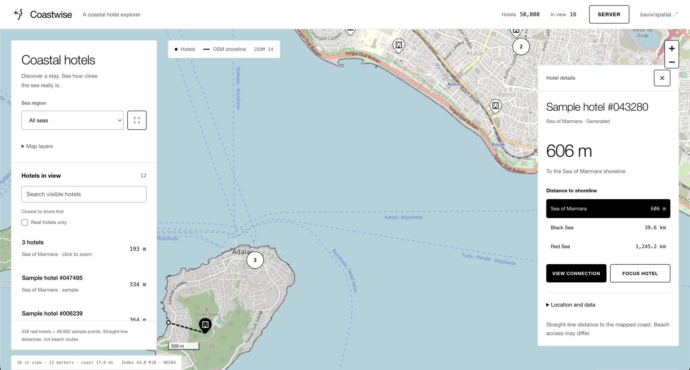

# Coastwise

A coastal hotel explorer powered by [bavix/spatial](https://github.com/bavix/spatial), Go 1.26, and Leaflet.



```sh
go run main.go
```

Open http://localhost:8080. Select a hotel to see its distances to the Black Sea, Red Sea, and Sea of Marmara.

```sh
npm ci
npm run dev
npm run build
```

Vite proxies the backend on port 8080. The production frontend and compressed JSON datasets are embedded in Go.

50,000 points include real [Hotels-50K](https://github.com/GWUvision/Hotels-50K) records and labelled samples. [Coastlines](https://osmdata.openstreetmap.de/data/coastlines.html), [water polygons](https://osmdata.openstreetmap.de/data/water-polygons.html), and map tiles: © [OpenStreetMap contributors](https://www.openstreetmap.org/copyright), [ODbL](https://opendatacommons.org/licenses/odbl/1-0/).
